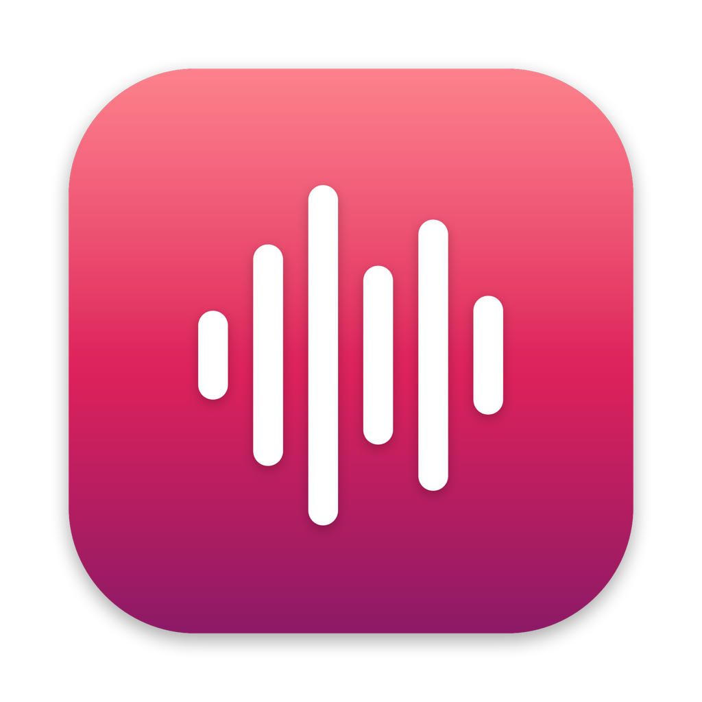
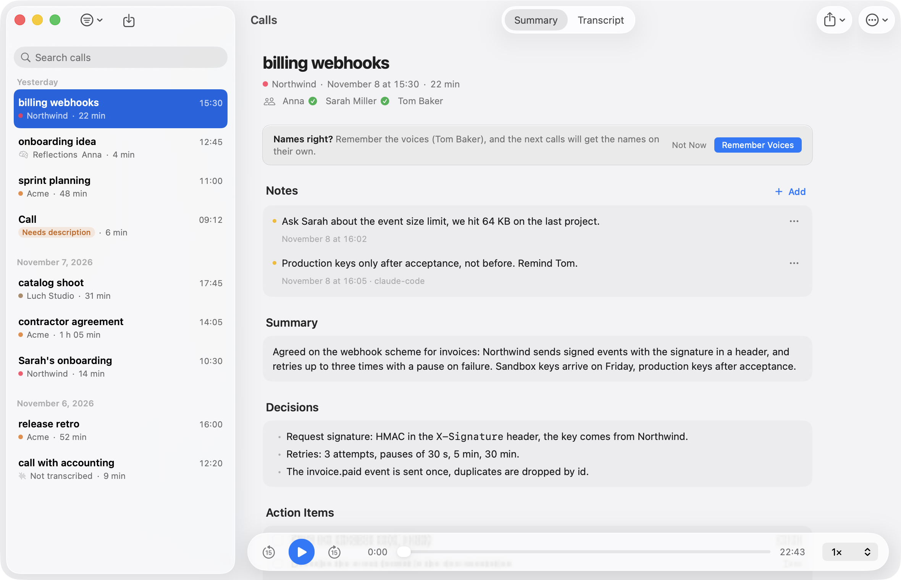
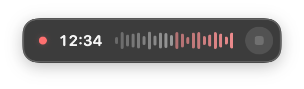
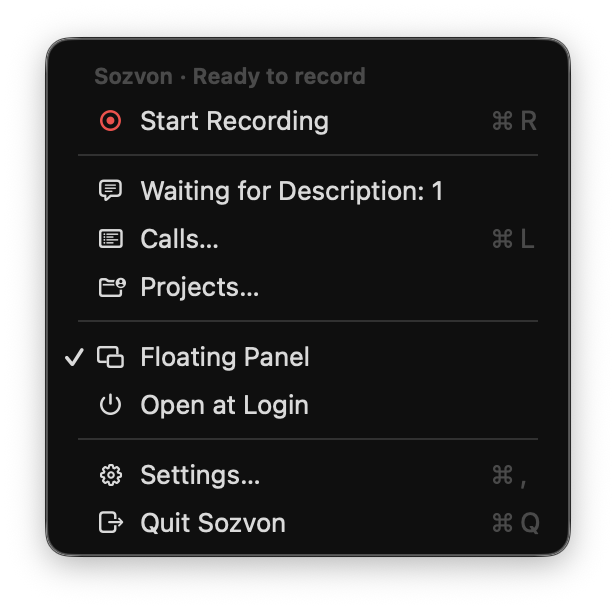
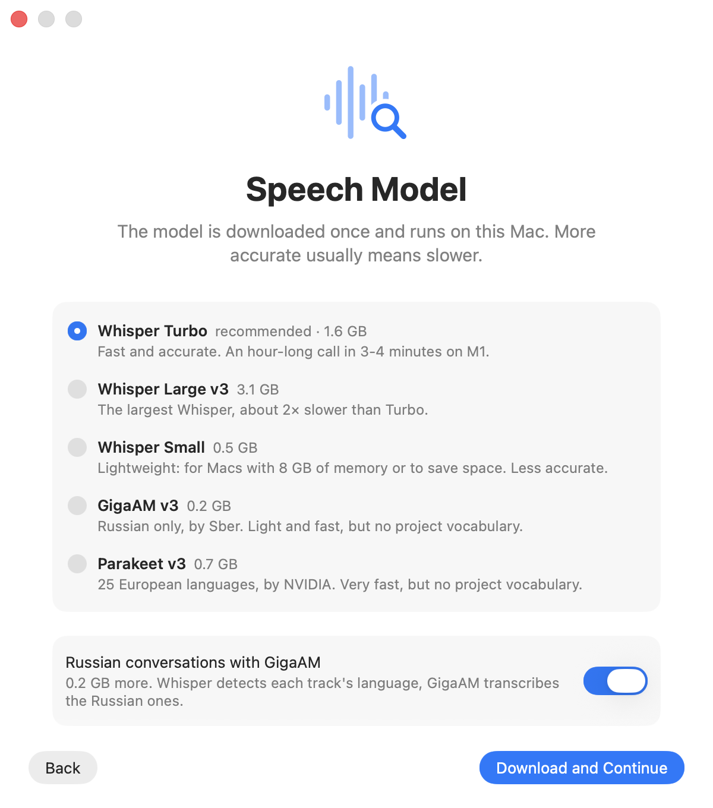
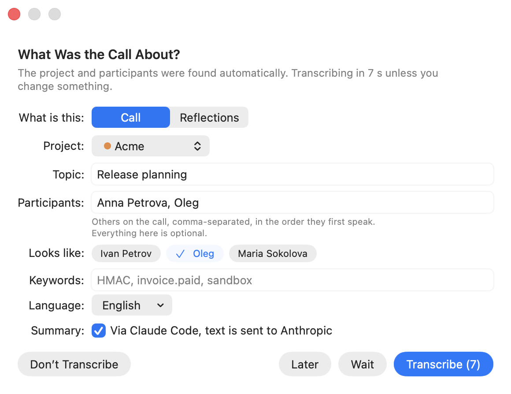

<p align="center"></p>

<h1 align="center">Sozvon</h1>

<p align="center">Records calls on your Mac and transcribes them locally: who said what, with timestamps, plus a summary with decisions and action items.</p>

<p align="center">
<a href="https://github.com/Able1991/sozvon/actions/workflows/ci.yml"></a>
<a href="https://github.com/Able1991/sozvon/actions/workflows/security.yml"></a>
<a href="LICENSE"></a>
</p>

<p align="center"><b><a href="https://github.com/Able1991/sozvon/releases/latest/download/Sozvon.dmg">Download for Mac</a></b> · <a href="https://able1991.github.io/sozvon/">Website</a> · <a href="https://able1991.github.io/sozvon/docs.html">Documentation</a> · <a href="README.ru.md">Русский</a></p>

<p align="center"><picture><source media="(prefers-color-scheme: dark)" srcset="docs/images/en-calls-dark.png"></picture></p>

## Features

Recording, transcription and speaker separation run on your Mac. Audio leaves it only for [your own server](#your-own-server-optional), if you set one up. Every detail is in the [documentation](https://able1991.github.io/sozvon/docs.html).

### Recording

- **One button.** A floating panel above all windows, or a menu bar icon. Works with Zoom, Google Meet, FaceTime, Telegram, TrueConf, anything. No virtual audio drivers.
- **Notices calls.** Asks "A call is on in Zoom. Record?". Can also start and stop by itself, if you turn that on.
- **Filled in from Calendar.** After Stop, the topic, people and project are already in the form.
- **Later.** No time to describe the call? It waits in the menu, and Sozvon reminds you.
- **Mark what matters.** Press the star or ⌃⌥I: that moment is starred in the transcript and explained in the summary.
- **Never a silent recording.** If your mic or the other side goes silent for two minutes, Sozvon captures that audio again.

### Clean sound

- **No echo without headphones.** The other side's voice is removed from your mic, on the Mac, with a small neural model (11 MB). Nearby voices are kept, though one much quieter than the speakers can come out quieter.
- **A quiet mic is raised.** And Sozvon warns you during the recording if you are barely audible.
- **Even volume in the player.** Loud stretches are lowered and quiet speech is raised a little.

### Who said what

- **Separate tracks.** You and the other side are recorded apart, and remote speakers are told apart by voice.
- **Names from the conversation.** The assistant works them out ("Masha, how are you?").
- **Knows voices.** Save your voice in 20 seconds. Name someone once, and later calls of that project name them by themselves. Voice prints are biometric data: they stay on your Mac (and your own server, if you use one), and you can delete any of them.
- **Summary** in the language of the call: overview, decisions, action items with owners, open questions. Optional, through Claude Code, Codex or Cursor on your own subscription.
- **Projects.** People, terms and replacements per client, so names and jargon are spelled right.
- **Multiple languages** in one call.

### Your calls

- **Calls window.** Grouped by day, with search across everything, including transcript text.
- **Listen along.** Click a line and the call plays from there, at up to 2x.
- **Fix the transcript.** Rename a speaker, swap two people, correct a word, and the project remembers the fix.
- **Notes.** Yours or an assistant's, shown under the call and found by search.
- **Tasks to Reminders.** Your action items go to Apple Reminders, with due dates when the call names a day.
- **Delete audio automatically** after 7, 15, 30 or 60 days. Transcripts, summaries and notes stay.

### Beyond calls

- **Reflections.** Think out loud and get the main point, an analysis, what to do and open questions.
- **Recordings from your phone.** Voice Memos saved to a folder are transcribed by themselves, or record in one tap with the [Think Out Loud shortcut](https://www.icloud.com/shortcuts/eca8c5ccf15d474db3490d66f4dadaf0) for iPhone.
- **Import recordings.** Drop an m4a, mp3, wav, mp4 or mov onto the Calls window.

### Assistants and other devices

- **Claude, Codex and Cursor read your calls** through [MCP](#claude-code-codex-and-cursor-mcp): "what did we decide with the client last week?".
- **Ask from your phone (optional).** Claude or ChatGPT answer while the Mac is off, through [your own server](#your-own-server-optional).
- **Sync across Macs.** A second Mac on the same server gets your calls, audio, notes and voices.

<p align="center">
<picture><source media="(prefers-color-scheme: dark)" srcset="docs/images/en-panel-dark.png"></picture>
&nbsp;
<picture><source media="(prefers-color-scheme: dark)" srcset="docs/images/en-menu-dark.png"></picture>
</p>

## Installation

1. Download `Sozvon.dmg` from [Releases](https://github.com/Able1991/sozvon/releases/latest) and drag Sozvon to Applications, or run `brew install --cask able1991/sozvon/sozvon`. The app is signed and notarized by Apple.
2. Launch it. The setup assistant asks for your name, the language of your calls, a recognition model and an assistant for summaries, then installs the engine: 5-10 minutes, 1-4 GB depending on the model. No tokens or sign-ups.
3. Allow the Microphone, Screen Recording and System Audio Recording (System Settings shows the last two under Screen & System Audio Recording; setup and Settings > General > Permissions have buttons for each). Video is not recorded, only audio. System audio comes through a Core Audio process tap, so FaceTime calls are heard too. Setup ends with a three second test recording that proves recording works before the first call; until setup is finished, the rest of the menu is unavailable. Access to Reminders is asked only when you first use To Reminders. The call prompt needs no permission.

**Updates** install themselves: once a day Sozvon downloads a new version in the background and installs it when there is no recording, call or open window. Versions before 0.1.2 need one manual update.

**Requirements:** a Mac with Apple silicon (M1 or later), macOS 15 Sequoia or later. For summaries and project discovery: [Claude Code](https://claude.com/code), [Codex CLI](https://github.com/openai/codex) or [Cursor CLI](https://cursor.com/cli) installed, optional.

<p align="center">
<picture><source media="(prefers-color-scheme: dark)" srcset="docs/images/en-setup-model-dark.png"></picture>
&nbsp;
<picture><source media="(prefers-color-scheme: dark)" srcset="docs/images/en-callinfo-dark.png"></picture>
</p>

## Recognition models

| Model | Size | Languages | Peak memory | Time for a 75 min call | Notes |
|---|---|---|---|---|---|
| **Whisper Turbo** (recommended) | 1.6 GB | 99 | 4.0 GB | 36 min | Fast and accurate, uses the project vocabulary |
| Whisper Large v3 | 3.1 GB | 99 | 4.9 GB | 68 min | Most accurate, about 2x slower |
| Whisper Small | 0.5 GB | 99 | 4.0 GB | 23 min | For Macs with 8 GB of memory |
| GigaAM v3 (Sber) | 0.2 GB | Russian | 3.2 GB | 20 min | Light and fast, no project vocabulary |
| Parakeet v3 (NVIDIA) | 0.7 GB | 25 European | 5.2 GB | 21 min | Very fast, no project vocabulary |

Peak memory and time: the whole processing of one 75-minute call with two tracks (echo removal, recognition, speaker separation), MacBook Pro M1 Pro with 16 GB, version 0.1.5. About 10 minutes of each run is speaker separation, the same for every model. Version 0.1.4 needed up to 17 GB for the same call with Whisper Turbo.

Speaker separation: [pyannote](https://github.com/pyannote/pyannote-audio) (31 MB, installed with the app). Switch models in Settings → Recognition. The same tab has "Transcribe at low priority": transcription yields to other apps.

## Claude Code, Codex and Cursor (MCP)

Settings → Assistants → Connect. Cursor has no `mcp add` command, so for Cursor Sozvon adds its entry to `~/.cursor/mcp.json` itself, keeping comments and other servers; the Cursor app and Cursor CLI both read that file. While running, Sozvon keeps one shared MCP server on `127.0.0.1` for all sessions (about 40 MB). The assistant gets these tools:

| Tool | What it does |
|---|---|
| `list_calls` | list calls: date, topic, project, people, duration; filter by any text |
| `get_call` | summary and/or transcript of a call, with its notes |
| `search_calls` | ranked search across all transcripts, summaries and notes, with timestamps; matches word forms; `also` takes 2-3 alternative phrasings of the query |
| `get_commitments` | what people promised: action items from the summaries, by person or project |
| `get_person` | a person across calls: how many and the last one, projects, who else was there, open commitments |
| `add_note` | leave a note on a call (a decision, a follow-up); it shows in the Calls window |
| `delete_note` | delete a note from a call, by the id `get_call` shows |
| `transcribe` | transcribe any audio or video file |
| `list_profiles`, `add_terms`, `add_replacement`, `remove_replacement` | projects, terms and replacements |
| `list_models`, `show_vocab`, `preview_prompt` | models, the vocabulary and the hint the model gets |

Manual setup and details: [documentation](https://able1991.github.io/sozvon/docs.html#mcp). The server requires the token from `~/Library/Application Support/Sozvon/.mcp-token`.

### Your own server (optional)

Ask Claude or ChatGPT about your calls from your phone or the web while the Mac is off. The server runs in your own free Cloudflare account, so your calls never reach us or any shared service, and you can delete everything at any time.

**Set up:** Settings > Cloud > Connect Cloudflare, then Allow. Open Claude (or ChatGPT) on the same tab adds it as a connector.

| What goes up | When |
|---|---|
| Text of your calls | always |
| Call audio | Send call audio, on by default. The free plan holds about 80 hours, then only text syncs |
| Voice prints | Send voice prints, on by default. Other people's voices are then your responsibility, including their consent |

- **Claude and ChatGPT get text only,** never audio or voice prints. They can list, read and search calls and add or delete notes, but never change or delete a call.
- **Second Mac.** Connect it to the same server: it downloads your calls with audio, notes and voices, and the connectors stay signed in.
- **Deleting.** Only calls you delete in Sozvon are deleted on the server. On your other Macs they go to the Trash.
- **Updates.** When a new Sozvon brings a new server, press Update server on the Cloud tab once.

How it works: [docs/SERVER.md](docs/SERVER.md).

## What goes online

| What | Where | When |
|---|---|---|
| Recording, transcription, echo removal, speaker separation, imported recordings | nowhere, only the calls folder (`~/Documents/Calls` unless you chose another) | always |
| The calls folder, audio and transcripts included | iCloud Drive, synced by macOS and not by Sozvon | only if Desktop & Documents Folders is on in iCloud Drive settings; turn it off, or move the calls folder out of Documents, to keep the calls off iCloud |
| Voice prints (your sample and the people you named) | nowhere, `~/Library/Application Support/Sozvon/voices` | once you record a sample or name a speaker |
| Live voice match during a recording (only if voices of other people are saved; pieces of the other side's audio, deleted as soon as they are matched) | nowhere, stays on the Mac | while recording |
| Which app is using the microphone (for the call prompt; only the app, never the audio) | nowhere, read on the Mac | always while Sozvon runs |
| The meeting at the time of a recording (title, attendees) for the call form | nowhere, read from Calendar on the Mac | after each recording, unless turned off in Settings |
| Tasks and notes you send to Reminders | nowhere, the Reminders app on this Mac (if Reminders syncs through iCloud, Apple syncs them further) | only when you press To Reminders |
| Recordings from your phone | the folder you chose (in iCloud Drive, Apple syncs the files and their move to Imported) | only if you choose a folder |
| Python environment, models | PyPI, huggingface.co | once, during setup |
| Echo removal model (11 MB) | huggingface.co | once, during setup, or at the first launch after the update that brings it |
| uv binary (if missing), CPython for `uv sync`, fallback archive of the speaker separation models (release `models-v1`) | github.com | once, during setup |
| Transcript text for the summary and speaker names | Anthropic (Claude Code), OpenAI (Codex) or Cursor and the model chosen in it | only if an assistant is selected |
| Whatever the assistant reads through MCP | Anthropic, OpenAI or Cursor | only when you ask it |
| Project discovery: project folder names, memory notes in `~/.claude` (or sessions in `~/.codex`, or past chats in `~/.cursor/projects`), replies of open sessions. Claude is limited to reading inside `~/.claude`. Codex runs in a `read-only` sandbox: it blocks writes but not reads, and the model itself decides what it reads. Cursor runs in read-only ask mode, and its limit to those folders is also only an instruction | Anthropic, OpenAI or Cursor | only when you click Find Projects |
| Updates | github.com: the latest release's appcast.xml, and the new DMG when there is one | once a day; automatic install can be turned off in Settings > About |
| Transcripts, summaries, notes and call details, so Claude or ChatGPT can answer from your phone | your own server in your own Cloudflare account, never us ([how it works](docs/SERVER.md)) | only if you set one up |
| Call audio, so a new Mac can play your calls (never shown to Claude or ChatGPT) | your own server in your own Cloudflare account | only with your own server and Send call audio on (the default) |
| Voice prints, so your other Macs recognize the same voices (never shown to Claude or ChatGPT) | your own server in your own Cloudflare account | only with your own server and Send voice prints on (the default) |
| Cloudflare sign-in and setup: creating the database, the sign-in storage and the Worker in your account | dash.cloudflare.com, api.cloudflare.com | only when you press Connect Cloudflare or Update server |

No telemetry and no servers of our own. Choose "Local only", skip the own server, and nothing except the update check leaves your Mac. Every commit is checked by [Gitleaks](https://github.com/gitleaks/gitleaks), [Semgrep](https://semgrep.dev) and [CodeQL](https://codeql.github.com).

## How it works

```
Package.swift       SwiftPM: SozvonCore (logic, covered by tests) + Sozvon (the app)
Sources/SozvonCore/ recording state, transcription queue, engine launcher, call.json, settings
Sources/Sozvon/     menu bar, recording (Core Audio process tap, ScreenCaptureKit), panel, SwiftUI windows, MCP server
Tests/              XCTest for SozvonCore
engine/
  sozvon_engine/    engine: recognition, pyannote, languages, vocabularies, projects, summary, MCP
  bin/              process_call.py (full pipeline), discover_projects.py (project discovery), sync_server.py (own server sync), voice.py (voice prints)
  server.py         MCP server (stdio or shared HTTP)
  models.json       models with pinned revisions
  setup.sh          installs the engine into ~/Library/Application Support/Sozvon
server/             optional own server: Cloudflare Worker + D1 + KV, MCP for Claude and ChatGPT connectors, sync API
docs/               website (GitHub Pages), CONTRACT.md (app and engine contract), SIGNING.md, SERVER.md
build.sh            builds the .app and .dmg, signing, notarization
```

After Stop: tracks are aligned → a very quiet track is raised and the other side's echo is removed from the microphone → recognition with hints from the project → speaker separation → names from saved voice prints, then from context → `transcript.md`, `summary.md` → the levelled `listen.m4a` for the player.

## Building and testing

```bash
git clone https://github.com/Able1991/sozvon && cd sozvon
./test.sh              # Python, localization, the own server (with Node.js 22+), Swift
SLOW=1 ./test.sh       # plus end-to-end tests with real Whisper
./build.sh install     # ~/Applications/Sozvon.app
./build.sh dmg         # build/Sozvon.dmg
```

Requires Xcode Command Line Tools and [uv](https://docs.astral.sh/uv/). Optional: Node.js 22 or later, to bundle the server into the app for Connect Cloudflare (without it the app builds, and the button says it is unavailable) and to run the server tests (`./test.sh` skips them without it; in CI they are required). Signing and releases: [docs/SIGNING.md](docs/SIGNING.md).

## License

MIT. Models: Whisper (MIT), pyannote (MIT, CC BY 4.0), GigaAM (MIT), Parakeet (CC BY 4.0), LocalVQE (Apache 2.0). The Windows engine uses the faster-whisper conversions of Whisper (MIT); `engine/sozvon_engine/assets/whisper-tokenizer.json` is the Whisper tokenizer from `Systran/faster-whisper-small` (MIT). On the CPU the Windows engine can use an ONNX export of the WeSpeaker ResNet34-LM speaker embedding model (authors: Hongji Wang et al., CC BY 4.0, from `pyannote/wespeaker-voxceleb-resnet34-LM`).
