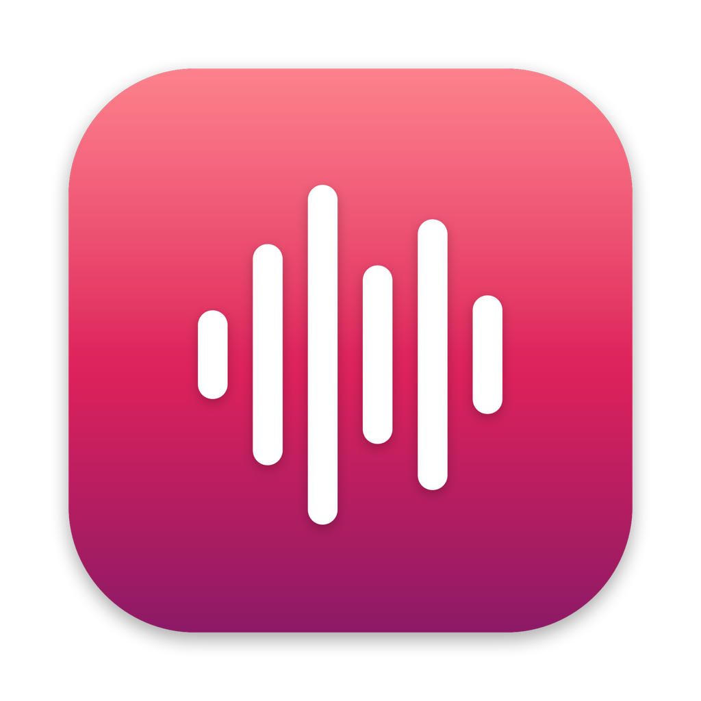
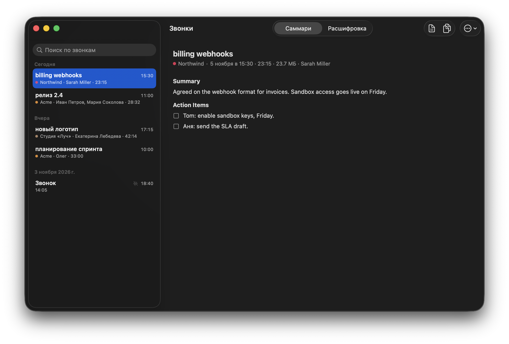
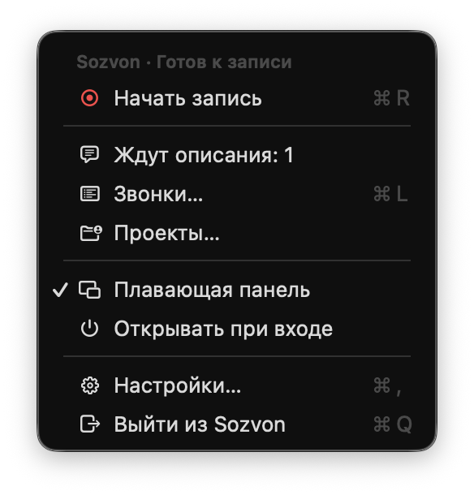
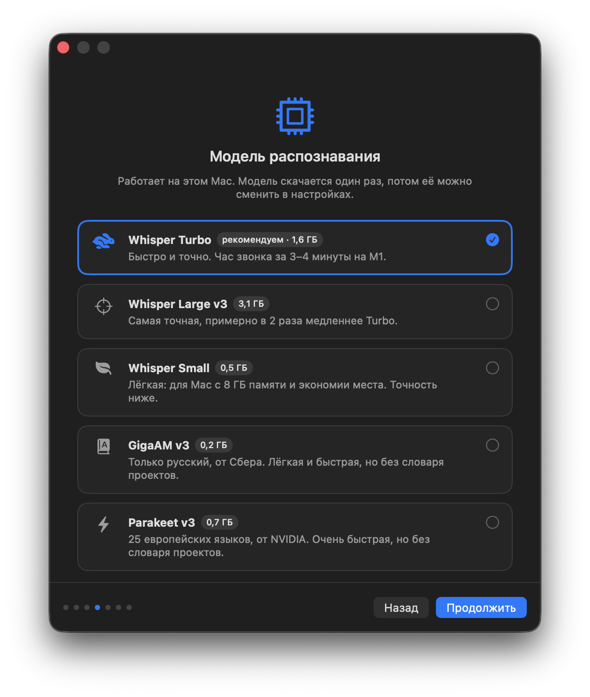
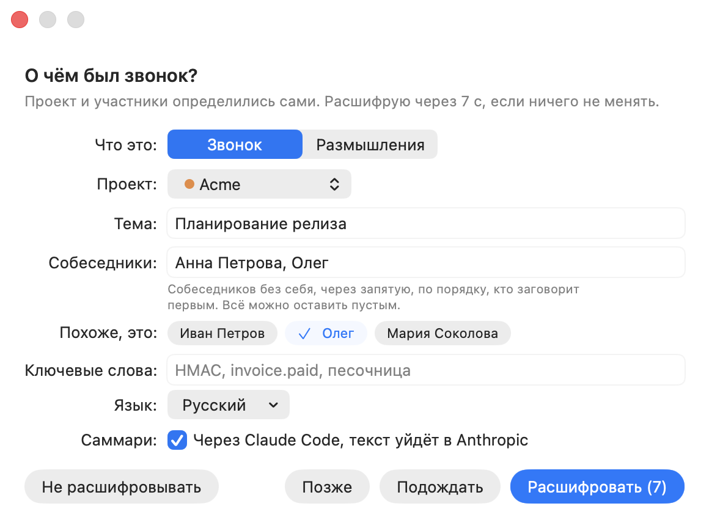

<p align="center"></p>

<h1 align="center">Sozvon</h1>

<p align="center">Записывает созвоны на Mac и расшифровывает их локально: кто что сказал, с таймкодами, плюс саммари с решениями и задачами.</p>

<p align="center">
<a href="https://github.com/Able1991/sozvon/actions/workflows/ci.yml"></a>
<a href="https://github.com/Able1991/sozvon/actions/workflows/security.yml"></a>
<a href="LICENSE"></a>
</p>

<p align="center"><b><a href="https://github.com/Able1991/sozvon/releases/latest/download/Sozvon.dmg">Скачать для Mac</a></b> · <a href="https://able1991.github.io/sozvon/">Сайт</a> · <a href="https://able1991.github.io/sozvon/docs.html">Документация</a> · <a href="README.md">English</a></p>

<p align="center"><picture><source media="(prefers-color-scheme: dark)" srcset="docs/images/ru-calls-dark.png"></picture></p>

## Что умеет

Запись, распознавание и разбивка по голосам идут на твоём Mac. Звук покидает его только ради [твоего собственного сервера](#свой-сервер-по-желанию), если ты его поднял. Все подробности в [документации](https://able1991.github.io/sozvon/docs.html).

### Запись

- **Одна кнопка.** Плавающая панель поверх всех окон или значок в строке меню. Работает с Zoom, Google Meet, FaceTime, Telegram, TrueConf, чем угодно. Без виртуальных аудиодрайверов.
- **Замечает звонки.** Спрашивает «Идёт звонок в Zoom. Записать?». Может и сам начинать и заканчивать запись, если это включить.
- **Заполняется из Календаря.** После «Стоп» тема, участники и проект уже в форме.
- **«Позже».** Некогда описывать звонок? Он подождёт в меню, а Sozvon напомнит.
- **Отметь важное.** Нажми звёздочку или ⌃⌥I: момент будет отмечен в расшифровке и разобран в итогах.
- **Запись не окажется немой.** Если микрофон или собеседники молчат две минуты, Sozvon заново подхватит звук.

### Чистый звук

- **Без эха и без наушников.** Голос собеседников убирается из твоего микрофона прямо на Mac, небольшой нейросетью (11 МБ). Голоса рядом сохраняются, хотя тот, что намного тише динамиков, может стать тише.
- **Тихий микрофон делается громче.** А если тебя почти не слышно, Sozvon предупредит прямо во время записи.
- **Ровная громкость в плеере.** Громкие места приглушены, тихая речь немного поднята.

### Кто что сказал

- **Разные дорожки.** Ты и собеседники пишетесь отдельно, а собеседники разводятся по голосам.
- **Имена из разговора.** Помощник понимает их по смыслу («Маша, как у тебя?»).
- **Узнаёт по голосу.** Сохрани свой голос за 20 секунд. Назови человека один раз, и в следующих звонках проекта он подпишется сам. Отпечатки голосов это биометрические данные: они остаются на твоём Mac (и твоём сервере, если он есть), любой можно удалить.
- **Саммари** на языке разговора: коротко, решения, задачи с исполнителями, открытые вопросы. По желанию, через Claude Code, Codex или Cursor по твоей подписке.
- **Проекты.** Люди, термины и автозамены по каждому клиенту, чтобы имена и жаргон писались правильно.
- **Несколько языков** в одном звонке.

### Твои звонки

- **Окно «Звонки».** Список по дням и поиск по всему, включая текст расшифровок.
- **Слушать вместе с текстом.** Нажми на реплику, и запись заиграет с этого места, скорость до 2x.
- **Правки расшифровки.** Переименуй говорящего, поменяй местами двоих, исправь слово, и проект запомнит замену.
- **Заметки.** Твои или ассистента, видны под звонком, их находит поиск.
- **Задачи в Напоминания.** Твои задачи уходят в Напоминания Apple, со сроком, если в звонке назвали день.
- **Автоудаление аудио** через 7, 15, 30 или 60 дней. Расшифровки, саммари и заметки остаются.

### Не только звонки

- **Размышления.** Думай вслух и получай главную мысль, анализ, что сделать и открытые вопросы.
- **Записи с телефона.** Диктофонные записи, сохранённые в папку, расшифровываются сами, а записать можно одним нажатием через [команду Think Out Loud](https://www.icloud.com/shortcuts/eca8c5ccf15d474db3490d66f4dadaf0) для iPhone.
- **Импорт записей.** Перетащи m4a, mp3, wav, mp4 или mov в окно «Звонки».

### Ассистенты и другие устройства

- **Claude, Codex и Cursor видят звонки** через [MCP](#claude-code-codex-и-cursor-mcp): «что решили с клиентом на прошлой неделе?».
- **Спроси с телефона (по желанию).** Claude или ChatGPT отвечают, когда Mac выключен, через [твой сервер](#свой-сервер-по-желанию).
- **Синхронизация между Mac.** Второй Mac с тем же сервером получает звонки, звук, заметки и голоса.

<p align="center">
<picture><source media="(prefers-color-scheme: dark)" srcset="docs/images/ru-panel-dark.png"></picture>
&nbsp;
<picture><source media="(prefers-color-scheme: dark)" srcset="docs/images/ru-menu-dark.png"></picture>
</p>

## Установка

1. Скачай `Sozvon.dmg` со страницы [Releases](https://github.com/Able1991/sozvon/releases/latest) и перетащи Sozvon в «Программы» или выполни `brew install --cask able1991/sozvon/sozvon`. Приложение подписано и нотаризовано Apple.
2. Запусти. Мастер спросит имя, язык звонков, модель распознавания и помощника для саммари, затем сам поставит движок: 5-10 минут, 1-4 ГБ в зависимости от модели. Токены и регистрации не нужны.
3. Разреши «Микрофон», «Запись экрана» и «Запись системного аудио» (в Системных настройках последние два в разделе «Запись экрана и системного аудио»; в мастере и в Настройках → Основные → Разрешения есть кнопки для каждого). Видео не записывается, только звук. Системный звук идёт через Core Audio process tap, поэтому слышно и звонки в FaceTime. Доступ к Напоминаниям спрашивается, только когда первый раз нажмёшь «В Напоминания», к Календарю при первом окне «О чём был звонок?». Вопросу «Записать?» в начале звонка разрешения не нужны.

**Обновления** приходят сами: раз в день Sozvon скачивает новую версию в фоне и ставит её, когда нет записи, звонка и открытых окон. Версии до 0.1.2 один раз обнови вручную.

**Требования:** Mac на Apple Silicon (M1 и новее), macOS 15 Sequoia или новее. Для саммари и поиска проектов: установленный [Claude Code](https://claude.com/code), [Codex CLI](https://github.com/openai/codex) или [Cursor CLI](https://cursor.com/cli), необязательно.

<p align="center">
<picture><source media="(prefers-color-scheme: dark)" srcset="docs/images/ru-setup-model-dark.png"></picture>
&nbsp;
<picture><source media="(prefers-color-scheme: dark)" srcset="docs/images/ru-callinfo-dark.png"></picture>
</p>

## Модели распознавания

| Модель | Размер | Языки | Особенности |
|---|---|---|---|
| **Whisper Turbo** (рекомендуем) | 1,6 ГБ | 99 | Быстро и точно, понимает словарь проекта |
| Whisper Large v3 | 3,1 ГБ | 99 | Самая большая Whisper, примерно в 2 раза медленнее Turbo; на звонках автора заметно точнее не стала |
| Whisper Small | 0,5 ГБ | 99 | Для Mac с 8 ГБ памяти |
| GigaAM v3 (Сбер) | 0,2 ГБ | русский | Лёгкая и быстрая, без словаря проектов |
| Parakeet v3 (NVIDIA) | 0,7 ГБ | 25 европейских | Очень быстрая, без словаря проектов |

Разбивка по голосам: [pyannote](https://github.com/pyannote/pyannote-audio) (31 МБ, ставится вместе с приложением). Модель меняется в «Настройки → Распознавание». Там же «Расшифровывать с низким приоритетом»: расшифровка уступает другим программам.

## Claude Code, Codex и Cursor (MCP)

«Настройки → Ассистенты → Подключить». У Cursor нет команды `mcp add`, поэтому для него Sozvon сам дописывает запись в `~/.cursor/mcp.json`, сохраняя комментарии и другие серверы; этот файл читают и приложение Cursor, и Cursor CLI. Sozvon держит один общий MCP-сервер на `127.0.0.1` для всех сессий (около 40 МБ), пока запущен. Ассистент получает инструменты:

| Инструмент | Что делает |
|---|---|
| `list_calls` | список звонков: дата, тема, проект, люди, длительность; фильтр по любому тексту |
| `get_call` | саммари и/или расшифровка звонка, с заметками |
| `search_calls` | поиск по всем расшифровкам, саммари и заметкам, с таймкодами: лучшие совпадения сверху, слова в любой форме; в `also` 2-3 альтернативные формулировки запроса |
| `get_commitments` | что люди обещали: задачи из саммари, по человеку или проекту |
| `get_person` | человек по всем звонкам: сколько их и последний, проекты, с кем ещё был, открытые обещания |
| `add_note` | оставить заметку к звонку (решение, договорённость); она видна в окне «Звонки» |
| `delete_note` | удалить заметку звонка по id, который показывает `get_call` |
| `transcribe` | расшифровать любой аудио- или видеофайл |
| `list_profiles`, `add_terms`, `add_replacement`, `remove_replacement` | проекты, термины и автозамены |
| `list_models`, `show_vocab`, `preview_prompt` | модели, словарь и подсказка, которую получит модель |

Подключить вручную и все подробности: [документация](https://able1991.github.io/sozvon/docs.html#mcp). Сервер требует пароль из `~/Library/Application Support/Sozvon/.mcp-token`.

### Свой сервер (по желанию)

Спрашивай Claude или ChatGPT о звонках с телефона или из браузера, когда Mac выключен. Сервер живёт в твоём бесплатном аккаунте Cloudflare, поэтому звонки не попадают ни к нам, ни в общий сервис, а удалить всё можно в любой момент.

**Как поднять:** «Настройки → Облако → Подключить Cloudflare», затем «Разрешить». Кнопка «Открыть Claude» (или ChatGPT) на той же вкладке добавит его как коннектор.

| Что уходит | Когда |
|---|---|
| Текст звонков | всегда |
| Звук звонков | «Отправлять аудио звонков», включено по умолчанию. Бесплатного тарифа хватает примерно на 4 часа, дальше синхронизируется только текст |
| Отпечатки голосов | Только если включить «Отправлять отпечатки голосов» (по умолчанию выключено: это биометрические данные). За голоса собеседников, в том числе за их согласие, тогда отвечаешь ты |

- **Claude и ChatGPT получают только текст,** никогда не звук и не голоса. Они могут смотреть, читать и искать звонки, добавлять и удалять заметки, но не меняют и не удаляют сами звонки.
- **Второй Mac.** Подключи его к тому же серверу: он скачает звонки со звуком, заметки и голоса, а коннекторы останутся подключёнными.
- **Удаление.** С сервера удаляются только звонки, удалённые в Sozvon. На других Mac они уходят в Корзину.
- **Обновления.** Когда в новой версии Sozvon приходит новый сервер, один раз нажми «Обновить сервер» на вкладке «Облако».

Как это устроено: [docs/SERVER.md](docs/SERVER.md), на английском.

## Что уходит в сеть

| Что | Куда | Когда |
|---|---|---|
| Запись, расшифровка, удаление эха, разбивка по голосам, импортированные записи | никуда, только `~/Documents/Calls` | всегда |
| Папка звонков вместе со звуком и расшифровками | iCloud Drive, синхронизирует macOS, а не Sozvon | только если в настройках iCloud Drive включены папки «Рабочий стол» и «Документы»; выключи их, чтобы звонки не попадали в iCloud |
| Отпечатки голосов (твой образец и люди, которых ты назвал) | никуда, `~/Library/Application Support/Sozvon/voices` | когда записал образец или назвал собеседника |
| Сравнение голосов во время записи (только если сохранены голоса других людей; куски звука собеседников, удаляются сразу после сравнения) | никуда, остаётся на Mac | во время записи |
| Какое приложение держит микрофон (для вопроса «Записать?»; только приложение, не звук) | никуда, читается на Mac | всегда, пока работает Sozvon |
| Встреча в момент записи (название, участники) для формы звонка | никуда, читается из Календаря на этом Mac | после каждой записи, если не выключено в настройках |
| Задачи и заметки, которые ты отправил в Напоминания | никуда, приложение «Напоминания» на этом Mac (если Напоминания синхронизируются через iCloud, дальше их синхронизирует Apple) | только по кнопке «В Напоминания» |
| Записи с телефона | выбранная тобой папка (в iCloud Drive Apple синхронизирует файлы и их перенос в Imported) | только если выбрать папку |
| Python-окружение, модели | PyPI, huggingface.co | один раз при установке |
| Модель для удаления эха (11 МБ) | huggingface.co | один раз: при установке или при первом запуске после обновления, которое её приносит |
| Бинарник uv (если его нет), CPython для `uv sync`, запасной архив моделей разбивки (релиз `models-v1`) | github.com | один раз при установке |
| Текст расшифровки для саммари и имён. Инструментов помощник для этого не получает: Claude запускается совсем без них, Codex без оболочки, твоих MCP-серверов, плагинов и веб-поиска, в пустой временной папке. У Cursor такого выключателя нет: он работает в режиме только для чтения (ask) внутри своей песочницы, в пустой временной папке, где твои MCP-серверы не одобрены | Anthropic (Claude Code), OpenAI (Codex) или Cursor и выбранная в нём модель | только если выбран помощник |
| То, что читает ассистент через MCP | Anthropic, OpenAI или Cursor | только когда ты его спрашиваешь |
| Поиск проектов: названия папок проектов, заметки памяти в `~/.claude` (или сессии в `~/.codex`, или прошлые чаты в `~/.cursor/projects`). Claude ограничен чтением внутри `~/.claude`; с `SOZVON_DISCOVER_ASK=1` в `.env` движка он ещё спрашивает открытые сессии Claude Code, о чём они. Codex запускается в песочнице `read-only`: она запрещает запись, но не чтение, и что он прочитает, решает сама модель. Cursor работает в режиме только для чтения (ask), ограничение папками у него тоже только в инструкции | Anthropic, OpenAI или Cursor | только по кнопке «Найти проекты» |
| Обновления | github.com: appcast.xml последнего релиза, при новой версии её DMG | раз в сутки; автоустановка отключается в Настройках → О программе |
| Расшифровки, саммари, заметки и данные звонков, чтобы Claude или ChatGPT отвечали с телефона | твой собственный сервер в твоём аккаунте Cloudflare, не к нам ([как устроено](docs/SERVER.md)) | только если ты его поднял |
| Звук звонков, чтобы на новом Mac их можно было слушать (Claude и ChatGPT его не видят) | твой собственный сервер в твоём аккаунте Cloudflare | только со своим сервером и включённым «Отправлять аудио звонков» (по умолчанию) |
| Отпечатки голосов, чтобы другие Mac узнавали те же голоса (Claude и ChatGPT их не видят) | твой собственный сервер в твоём аккаунте Cloudflare | только со своим сервером и если включить «Отправлять отпечатки голосов» (по умолчанию выключено) |
| Вход в Cloudflare и настройка: база, хранилище входов и Worker в твоём аккаунте | dash.cloudflare.com, api.cloudflare.com | только по кнопке «Подключить Cloudflare» или «Обновить сервер» |

Никакой телеметрии и своих серверов. Выбери «Только локально», не поднимай свой сервер, и ничего, кроме проверки обновлений, не покинет Mac. Каждый коммит проверяют [Gitleaks](https://github.com/gitleaks/gitleaks), [Semgrep](https://semgrep.dev) и [CodeQL](https://codeql.github.com).

## Устройство

```
Package.swift       SwiftPM: SozvonCore (логика, покрыта тестами) + Sozvon (приложение)
Sources/SozvonCore/ состояние записи, очередь расшифровки, запуск движка, call.json, настройки
Sources/Sozvon/     строка меню, запись (Core Audio process tap, ScreenCaptureKit), панель, окна на SwiftUI, MCP-сервер
Tests/              XCTest для SozvonCore
engine/
  sozvon_engine/    движок: распознавание, pyannote, языки, словари, проекты, саммари, MCP
  bin/              process_call.py (полный цикл), discover_projects.py (поиск проектов), sync_server.py (синхронизация со своим сервером), voice.py (отпечатки голосов)
  server.py         MCP-сервер (stdio или общий HTTP)
  models.json       модели с закреплёнными версиями
  setup.sh          установка движка в ~/Library/Application Support/Sozvon
server/             свой сервер по желанию: Cloudflare Worker + D1 + KV, MCP для коннекторов Claude и ChatGPT, API синхронизации
docs/               сайт (GitHub Pages), CONTRACT.md (договор приложения и движка), SIGNING.md, SERVER.md
build.sh            сборка .app и .dmg, подпись, нотаризация
```

После «Стоп»: дорожки выравниваются → очень тихая дорожка становится громче, из микрофона убирается эхо собеседника → распознавание с подсказкой из проекта → разбивка по голосам → имена по сохранённым голосам, затем по смыслу → `transcript.md`, `summary.md` → выровненный `listen.m4a` для плеера.

## Сборка и тесты

```bash
git clone https://github.com/Able1991/sozvon && cd sozvon
./test.sh              # Python, переводы, свой сервер (при Node.js 22+), Swift
SLOW=1 ./test.sh       # плюс сквозные тесты на настоящем Whisper
./build.sh install     # ~/Applications/Sozvon.app
./build.sh dmg         # build/Sozvon.dmg
```

Нужны Xcode Command Line Tools и [uv](https://docs.astral.sh/uv/). По желанию Node.js 22 или новее: чтобы вложить сервер в приложение для «Подключить Cloudflare» (без него приложение соберётся, а кнопка скажет, что недоступна) и запускать тесты сервера (без него `./test.sh` их пропускает, в CI они обязательны). Подпись и релизы: [docs/SIGNING.md](docs/SIGNING.md).

## Лицензия

MIT. Модели: Whisper (MIT), pyannote (MIT, CC BY 4.0), GigaAM (MIT), Parakeet (CC BY 4.0), LocalVQE (Apache 2.0). Движок для Windows использует конвертации Whisper для faster-whisper (MIT); `engine/sozvon_engine/assets/whisper-tokenizer.json` это токенайзер Whisper из `Systran/faster-whisper-small` (MIT). На процессоре движок для Windows может использовать экспорт в ONNX модели голосовых отпечатков WeSpeaker ResNet34-LM (авторы: Hongji Wang и др., CC BY 4.0, из `pyannote/wespeaker-voxceleb-resnet34-LM`).
